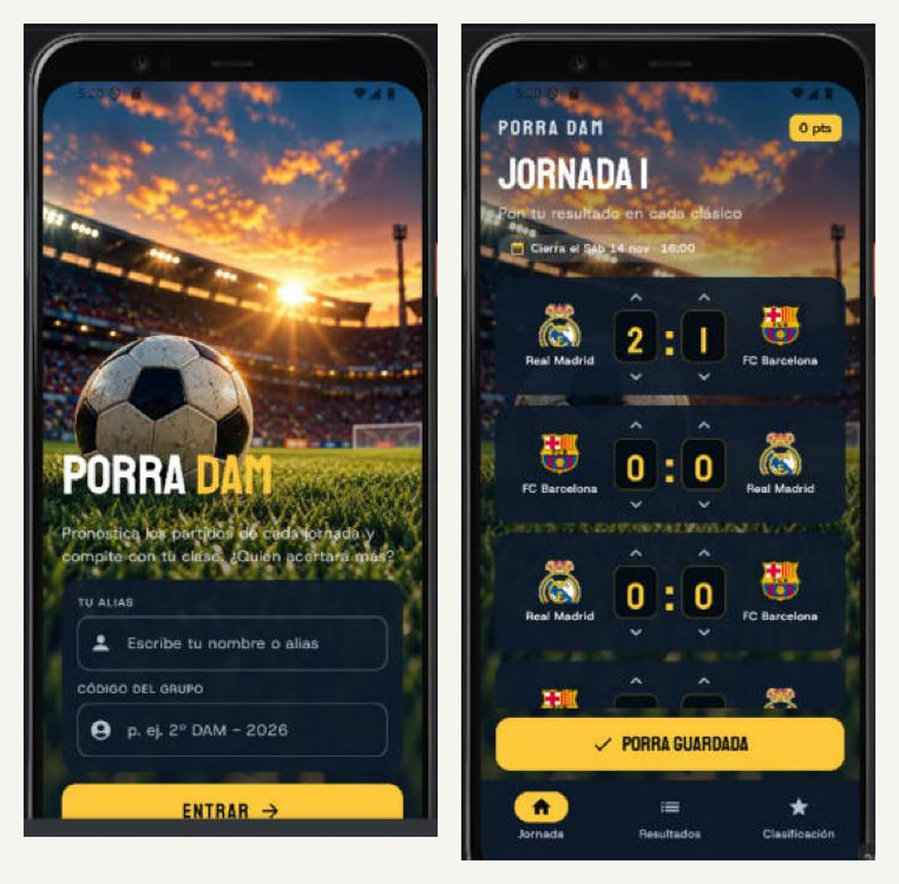

# Porra DAM

Miniproyecto de **Programación Multimedia y Dispositivos Móviles** (2º DAM · IES El Campico).
Entrega de la **UI del Tema 2**: pantallas *Bienvenida* y *Jornada* hechas con Jetpack Compose.

Autor: Francisco Pardo Hernández · Etiqueta de la entrega: `v0.1-tema2`



## Qué hace

- **Bienvenida:** foto de fondo a pantalla completa, título y botón para entrar.
- **Jornada:** cinco partidos de prueba. El marcador de cada equipo se cambia con las flechas (entre 0 y 9).
  Los pronósticos se guardan con el botón **Guardar mi porra** y **no se pierden al girar el móvil**
  porque viven en `JornadaViewModel`.
- **Regla de puntuación** (`domain/calcularPuntos`) con sus tests en `src/test` (5 tests en verde).

## Estructura (paquetes por capas)

```
org/elcampico/porradam/
  MainActivity.kt
  data/model/        Equipo, Marcador, Partido
  data/              JornadaDePrueba
  domain/            calcularPuntos
  ui/components/     EscudoEquipo, MarcadorSelector, PartidoCard, FondoEstadio
  ui/jornada/        PantallaJornada, JornadaViewModel
  ui/bienvenida/     PantallaBienvenida
  ui/theme/          Color, Type, Theme
```

## Fuera de los temas 1 y 2 (EXTRA)

- Campos de texto de Bienvenida (`OutlinedTextField`).
- Barra inferior (`NavigationBar`, Tema 3): solo se dibuja.
- Escudos como imagen en lugar del círculo de color con iniciales.

## Cómo ejecutarlo

Abrir la carpeta en Android Studio, esperar al *Gradle sync* y pulsar ▶ con un emulador (API 24 o superior).

## Análisis MP.3

Tabla de capas y partido mal puntuado del mockup: [`docs/MP3_Analisis.md`](docs/MP3_Analisis.md).
